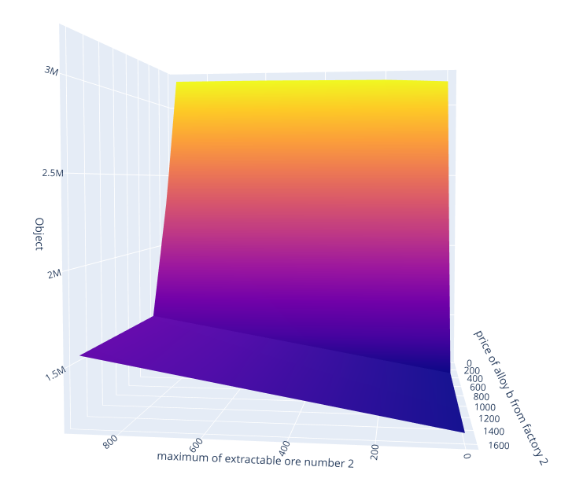
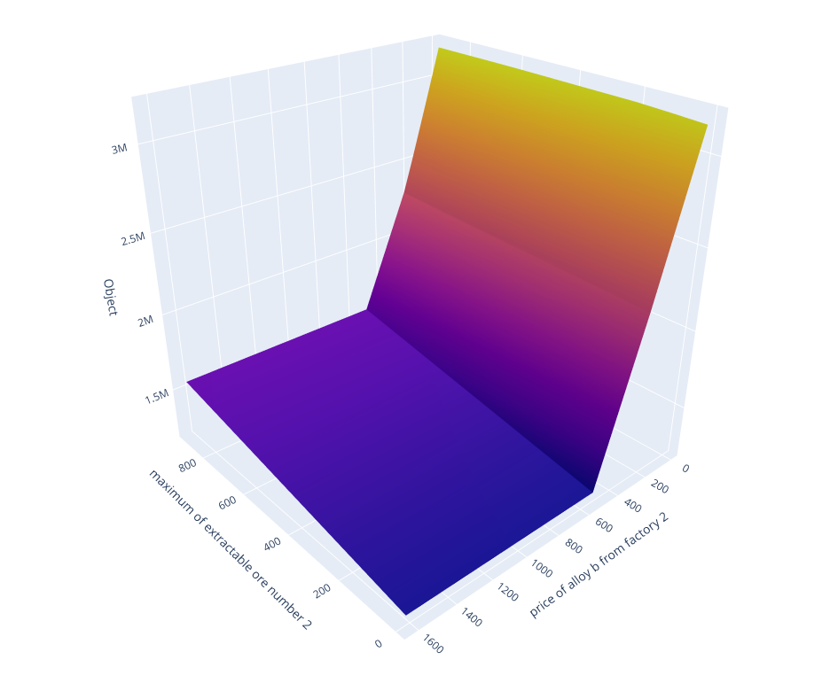
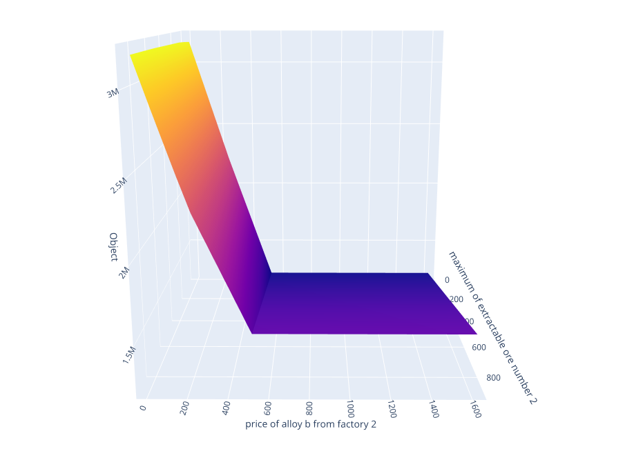

# Integrated Production and Distribution Optimization
### Operations Research | Mixed-Integer Linear Programming | Python & Pyomo

This project develops an integrated optimization model for the production, procurement, transportation, and distribution of metal alloys. The objective is to **maximize net operating returns** while simultaneously accounting for raw-material availability, alloy composition requirements, supplier contracts, container capacities, transportation costs, depot limitations, and market demand.

The model is formulated using **Mixed-Integer Linear Programming (MILP)** in **Pyomo**, solved with **GLPK**, and extended through scenario-based and sensitivity analyses.

> **Project context:** Operations Research coursework, Fall 2024. The accompanying report documents the mathematical implementation, model outputs, and scenario analyses. The numerical results below are those reported in the project documentation; they have not been independently revalidated here.

## 1. Problem overview

A metal-alloy supply network must decide how much ore to extract, how to combine the recovered metals into different alloys, whether to purchase additional alloys from external factories, and how to ship products through distribution depots to final markets.

The optimization jointly determines:

- **Raw-material allocation:** quantities extracted from each ore source and amounts of iron, aluminum, zinc, and copper allocated to alloy production.
- **Production mix:** quantities of alloys **A** and **B**, subject to their specified chemical-composition bounds.
- **Procurement decisions:** quantities purchased from two external suppliers, with contractual minimums, maximums, and fixed contract costs.
- **Transportation decisions:** quantities of each alloy and integer numbers of containers shipped from factories to depots and from depots to markets.
- **Demand allocation:** the markets served and the volumes sold without exceeding market-specific demand.
- **Commercial scenarios:** supplier volume discounts, cost and capacity changes, and an additional market in Abadan.

### Network represented in the dataset

| Layer | Elements |
| --- | --- |
| Ore sources | 3 sources |
| Metals | Iron, aluminum, zinc, copper |
| Products | Alloy A and alloy B |
| Supply / production locations | Main factory and external factories 1 and 2 |
| Distribution depots | Tehran and Isfahan |
| Initial sales markets | Mashhad, Kerman, Ahvaz, Tabriz |
| Additional scenario | Abadan market |
| Container capacity | 100 units per container, as specified in `params.dat` |

The dataset specifies extraction limits and costs, metal content per ore source, alloy composition requirements, procurement prices, contract thresholds, shipping restrictions, market prices, and demand ceilings.

## 2. Optimization formulation

### Objective

The model maximizes **sales revenue minus operating and logistics costs**, with adjustments for optional scenarios:

Net Return = Sales Revenue
           - Ore Extraction Costs
           - Alloy Processing Costs
           - Purchased Alloy Costs
           - Contract Costs
           - Transportation Costs
           + Applicable Discounts

When the Abadan extension is enabled, the objective also includes revenue from that market and the associated shipping costs.

### Decision variables

The Pyomo formulation combines several variable types:

| Category | Examples | Type |
| --- | --- | --- |
| Extraction and alloy composition | Ore extraction; quantities of each metal used in each alloy | Continuous, nonnegative |
| Alloy quantities | Production and shipment volumes | Continuous, nonnegative |
| Procurement / supplier selection | Whether an external factory is used | Binary |
| Container allocation | Containers on factory–depot and depot–market routes | Nonnegative integer |
| Route activation | Whether a depot–market route is selected | Binary |
| Discount activation | Whether a supplier's discount threshold is reached | Binary |

### Major constraints

1. **Ore availability:** extracted quantities cannot exceed the capacity of each ore source.
2. **Metal availability:** metal use cannot exceed the amounts recoverable from extracted ore.
3. **Alloy quality:** the fractions of iron, aluminum, zinc, and copper must meet the prescribed lower and upper bounds for alloys A and B.
4. **Production and procurement:** outbound shipments must respect in-house production and supplier purchase limits.
5. **Supplier contracts:** purchase quantities and selected suppliers are linked using binary variables.
6. **Container capacities:** shipped alloy volumes must fit within the number of allocated containers.
7. **Depot throughput:** incoming container flows must satisfy depot-level limits.
8. **Flow conservation:** each depot's outbound alloy shipments are limited by incoming material.
9. **Market demand:** sales cannot exceed the demand limit for each alloy in each destination market.
10. **Scenario-specific rules:** discount thresholds and additional-market shipping constraints are introduced for their corresponding cases.

The complete executable formulation is in [`model.py`](model.py), while the input instance is defined in [`params.dat`](params.dat).

## 3. Methodology and tools

- **Python:** model implementation and scenario scripts.
- **Pyomo:** algebraic modeling of the mixed-integer optimization problem.
- **GLPK:** mathematical optimization solver (called through Pyomo).
- **NumPy:** parameter sweeps and numerical analysis.
- **Matplotlib:** 2D scenario and cost-sensitivity plots.
- **Plotly:** interactive 3D objective-surface visualization.
- **Jupyter Notebook:** step-by-step explanation, analysis, and documented outputs.

The core model is defined as a Pyomo `AbstractModel`, allowing model structure and scenario inputs to be maintained separately. `model_runner.py` loads the instance, applies scenario modifications, invokes GLPK, and reports the resulting decisions or objective values.

## 4. Scenarios and sensitivity analysis

In addition to the base optimization, the report explores how the preferred production, procurement, and distribution plan responds to changes in business conditions.

| Scenario | Question investigated |
| --- | --- |
| Base case (`-a`) | What production, purchasing, and distribution decisions maximize the objective under the initial assumptions? |
| Supplier discount (`-b`) | How does a purchase-volume discount affect supplier selection and overall returns? |
| Processing-cost sensitivity (`-d`) | How does the ore-to-alloy processing cost influence the use of the main factory? |
| Contract-cost sensitivity (`-e`) | At what supplier contract-cost levels do procurement decisions change? |
| Capacity and shipping-cost sensitivity (`-g`) | How do depot receiving requirements and factory-to-depot shipping costs affect the objective? |
| Transportation-cost sensitivity (`-h`) | What happens when freight costs increase or decrease by 10%, including individual route experiments? |
| New-market extension (`-i`) | How do prices in the additional Abadan market affect sales and distribution decisions? |

The report also includes sensitivity-analysis output for a **continuous LP relaxation**. This analysis should be distinguished from sensitivity or optimality statements for the original mixed-integer model.

### 3D objective visualization

The three provided images show alternative viewing angles of a three-dimensional response surface associated with:

- the maximum extractable quantity of **ore source 2**;
- the procurement price of **alloy B from factory 2**; and
- the value of the optimization objective.



*Figure 1. Objective surface for two simultaneously varied model parameters.*

| Alternate view | Alternate view |
| --- | --- |
|  |  |

*Figures 2–3. Additional viewing angles of the same two-parameter response surface.*

The surface illustrates the model's **piecewise response** to parameter changes: a parameter may be important in one region but have limited effect elsewhere, depending on which decisions and constraints are active. These are illustrative model-generated results, not empirical measurements.

## 5. Reported optimization results

The project report includes the following recorded results:

| Model configuration | Reported objective value | Solver status in the report |
| --- | ---: | --- |
| Base model (Problem A) | 1,037,982.73 | Optimal |
| Model with supplier volume discount (Problem B) | 1,107,067.58 | Optimal |

The reported improvement from the base case to the discount case is **69,084.85**, or approximately **6.7%** relative to the base objective value. These values are expressed in the problem's model units; no external currency is assumed.

In the reported base-case solution, the main factory and external factory 1 are selected, while external factory 2 is not selected. The report also lists production quantities, ore extraction, shipment flows, and container allocations for each stage of the network.

**Interpretation:** The results demonstrate how procurement incentives can change the relative attractiveness of alternative operational plans. Changes in transportation costs, supplier contract costs, and capacity restrictions are investigated separately rather than assuming that a single optimization solution is robust to all conditions.

## 6. Repository contents

```text
.
├── model.py                 # Pyomo optimization formulation and optional extensions
├── model_runner.py          # Solve selected cases and run sensitivity experiments
├── model.ipynb              # Walkthrough, documented model outputs, and analysis
├── params.dat               # Model sets and numerical parameters
├── OR_PROJECT_PHASE_2.pdf   # Detailed project report
├── model.lp                 # Exported solver-format model
├── modified_model.lp        # Modified solver-format model for additional analysis
├── results.yaml             # Saved solver metadata from a run
├── sensit.sen               # Sensitivity report from an LP-based analysis
├── plotG1.png               # Objective surface, first viewing angle
├── plotG2.png               # Objective surface, second viewing angle
├── plotG3.png               # Objective surface, third viewing angle
└── README.md                # This file
```

Generated solver files (`*.lp`, `results.yaml`, and `sensit.sen`) are included for reference and may be overwritten by subsequent runs.

## 7. Running the project

### Prerequisites

Install Python and the **GLPK** solver. The command-line program `glpsol` should be available on your system path.

Install the required Python packages:

```bash
pip install pyomo numpy matplotlib plotly jupyter
```

From the repository directory, execute the base case:

```bash
python model_runner.py -a
```

For the supplier-discount case:

```bash
python model_runner.py -b
```

For the implemented experiment groups:

```bash
python model_runner.py -d
python model_runner.py -e
python model_runner.py -g
python model_runner.py -h
python model_runner.py -i
```

Alternatively, open `model.ipynb` in Jupyter to explore the mathematical formulation and recorded results:

```bash
jupyter notebook model.ipynb
```

**Reproducibility note:** The repository contains research/coursework code and saved outputs, rather than a fully tested software package. Some cases require reviewing the execution script and solver setup before reproducing every result. In particular, certain report sections are documented in the notebook rather than exposed as standalone command-line options. The 3D plotting routine exists in `model_runner.py`, but its call is currently commented out in the `-g` branch.

## 8. Project takeaways

This project brings together production planning, raw-material allocation, supplier selection, transportation optimization, and commercial decision-making in one mathematical model. It demonstrates practical use of:

- **Mixed-integer optimization** for decisions involving continuous flows, integer container counts, and binary supplier/route choices.
- **Integrated supply-chain modeling** across production, procurement, intermediate depots, and final demand.
- **Scenario-based analysis** for examining threshold effects, alternate markets, and changes in costs and capacities.
- **Computational optimization workflows** using Python, Pyomo, GLPK, and numerical visualization tools.

## 9. Documentation

For the full formulation, annotated implementation, detailed solver outputs, and sensitivity experiments, consult [`OR_PROJECT_PHASE_2.pdf`](OR_PROJECT_PHASE_2.pdf) and [`model.ipynb`](model.ipynb).

---

*Academic operations research project — Fall 2024.*
